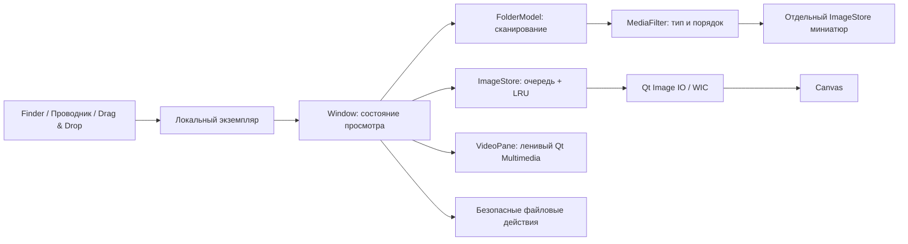

# KADRO

**Фото и видео. В одном окне.**

Локальный просмотрщик для Windows и macOS. Открываешь файл — листаешь соседние. Никакого импорта в библиотеку, регистрации, сервера или телеметрии.

Версия 0.1.0 — первая реализация, не финальный релиз. Наличие кода и зелёные автоматические тесты не заменяют проверку сборки на реальных Windows/Mac, HEIC с iPhone и аппаратного декодирования. Текущий результат проверок фиксируется в `docs/VALIDATION.md`.

## Что уже реализовано

- Фото и видео из одной папки; фильтры **Все / Фото / Видео**; естественная сортировка `1, 2, 10`, по дате и размеру. Нерекурсивное сканирование в рабочем потоке.
- Открытие выбранного фото независимо от сканирования папки. Декодирование вне интерфейса, подготовка двух соседних фото, ограниченный кеш и отдельная очередь миниатюр. Видеоплеер создаётся только при первом видео.
- Масштаб колесом, перемещение увеличенного изображения, вписывание, исходный масштаб и поворот **только вида**, без перезаписи оригинала. EXIF-ориентация и перевод встроенного цветового профиля в sRGB через Qt.
- Воспроизведение видео, пауза, перемотка, громкость, выключение звука, скорость 0,5–2×, ограниченное сохранение позиций. GIF/поддерживаемые Qt анимации без кеширования всех кадров.
- Выдвижная лента миниатюр, панель сведений, полный экран, скрытие панелей, светлая и тёмная темы, слайд-шоу.
- Показать в Finder/Проводнике, копировать файл или путь, безопасно переименовать и отправить **в корзину** с подтверждением. При ошибке корзины безвозвратного удаления нет.
- Перетаскивание файла/папки, открытие из командной строки, обработка открытия файлов Finder, один экземпляр приложения через локальный канал текущего пользователя.
- Регистрация в списке приложений Windows по явному действию пользователя и описание типов файлов в macOS bundle. Системный выбор приложения по умолчанию не перехватывается.

Лента пока показывает значок воспроизведения вместо кадров-превью видео. Скрытые файлы и вложенные папки намеренно не включаются в список. При перетаскивании нескольких объектов открывается первый локальный объект; произвольного плейлиста из разных папок пока нет.

## Форматы без обещания «открывает всё»

| Категория | Путь декодирования | Ограничения |
|---|---|---|
| JPEG, PNG, BMP, GIF, ICO | Qt Image IO | Файл должен быть корректным |
| WebP, TIFF | Qt Image Formats | Плагины должны попасть в готовую сборку |
| HEIC / HEIF | Нативный плагин Qt на Mac; WIC на Windows | Windows требует установленного подходящего HEIF-кодека; без него показывается понятная ошибка |
| AVIF | Установленный плагин Qt или WIC | Поддержка не гарантируется в стандартной поставке |
| MP4, MOV, MKV, WebM, AVI и др. | Qt Multimedia / FFmpeg | Расширение контейнера не гарантирует наличие нужного кодека; HDR/Dolby Vision не заявлены |

RAW, Live Photo как единый объект, профессиональный HDR/широкий цветовой охват и редактирование файлов не входят в 0.1.0. Нативный WIC-путь требует отдельной проверки ориентации и цвета настоящих HEIC перед выпуском.

## Быстрый старт разработчика

Нужны CMake 3.24+, компилятор C++20 и Qt **6.5+** с Widgets, Concurrent, Network, Multimedia, MultimediaWidgets, Test. CI использует фиксированный Qt **6.8.3**, а не плавающий `latest`. Для WebP/TIFF/HEIC на Mac также устанавливается Qt Image Formats.

```sh
cmake -S . -B build -G Ninja -DCMAKE_BUILD_TYPE=Release -DBUILD_TESTING=ON
cmake --build build --parallel
ctest --test-dir build --output-on-failure
```

Если Qt не найден, передайте `-DCMAKE_PREFIX_PATH=/путь/к/Qt/6.8.3/платформа`. На Windows запускайте команды в окружении MSVC 2022; Qt должен быть собран для того же компилятора. На Mac задайте `-DCMAKE_OSX_ARCHITECTURES="arm64;x86_64"` только с универсальным комплектом зависимостей.

Запуск:

```sh
# Windows: build/Kadro.exe "C:\Фото\IMG_1234.jpg"
# macOS: open build/Kadro.app --args "/путь/IMG_1234.heic"
# Linux используется для разработки и headless-проверок:
./build/Kadro /путь/к/папке
```

Программа работает с локальными путями. Сетевые URL не поддерживаются. Локально смонтированные сетевые диски обрабатываются системой и могут быть медленными.

### Сборка для передачи пользователю

```sh
cmake --install build --prefix dist --config Release
```

В Windows запускается `dist/bin/Kadro.exe`; передавать надо **всю** папку `dist`, не один EXE. В macOS — `dist/Kadro.app`. Workflow `Desktop builds` собирает Windows x64, универсальный Mac и проверяет Linux. Архив Mac сохраняет символьные ссылки внутри bundle. Пакеты появляются в Actions → нужный запуск → Artifacts, только после успешных тестов.

Подпись Windows и notarization Apple ещё не настроены. До отдельной проверки лицензий комплектуемых библиотек и подписания это тестовые пакеты, не публичный установщик. Приложение не отключает системные проверки безопасности.

### Сделать просмотрщиком по умолчанию

**Windows:** поместите папку приложения на постоянное место → в KADRO меню `•••` → «Приложение по умолчанию…» → выберите форматы в параметрах Windows. Регистрация только для текущего пользователя, без прав администратора и изменения `UserChoice`.

**macOS:** перенесите `Kadro.app` в «Программы» → свойства файла в Finder → «Открывать в программе» → KADRO → изменить для всех файлов этого типа.

## Управление

| Действие | Клавиши |
|---|---|
| Предыдущий / следующий | ← / → |
| Первый / последний | Home / End |
| Масштаб и перемещение | Колесо, перетаскивание |
| Вписать / исходный масштаб | F / 1 |
| Повернуть вид | R |
| Пауза видео или анимации | Пробел |
| Перемотка видео ±5 секунд | Ctrl/Cmd + ← / → |
| Миниатюры / сведения | T / I |
| Слайд-шоу | S |
| Полный экран | F11 / двойной щелчок |
| Скрыть панели / вернуть | Tab / Esc |
| Открыть / открыть папку | Ctrl/Cmd+O / Ctrl/Cmd+Shift+O |
| Показать в папке | Ctrl/Cmd+R |
| Копировать файл / путь | Ctrl/Cmd+C / Ctrl/Cmd+Shift+C |
| Переименовать / в корзину | F2 / Delete |

## Архитектура



`src/core` не зависит от Qt: классификация расширений, естественная сортировка, проверка имён, навигация и расчёт размеров. Его можно собрать и проверить отдельно:

```sh
cmake -S . -B build-core -DKADRO_BUILD_APP=OFF -DCMAKE_BUILD_TYPE=Release
cmake --build build-core
ctest --test-dir build-core --output-on-failure
```

Кеш изображений — 128 МиБ, миниатюр — 24 МиБ, декодированное изображение ограничивается 24 млн пикселей, Qt allocation limit — 128 МиБ на чтение. Это **не лимит всей памяти процесса**: показанный кадр, промежуточные буферы, мультимедиа и GPU расходуют память дополнительно. При 1:1 слишком большие изображения остаются ограниченными; фактический размер в памяти виден в сведениях.

Настройки хранятся локально через QSettings: геометрия, тема, лента, последняя папка диалога, громкость и до 64 позиций видео. Позиции привязаны к хешу пути/размера/даты, содержимое файлов не хешируется. При обычном запуске последнее фото автоматически не открывается. Постоянного дискового кеша миниатюр нет.

## Дальнейшая работа

`docs/CODEX_HANDOFF.md` — продолжение без повторного проектирования с нуля. `docs/VALIDATION.md` — что проверено и что нет. Сначала реальный запуск пакетов, затем измерения и полировка; не выдавать набор файлов за готовый проверенный релиз.
