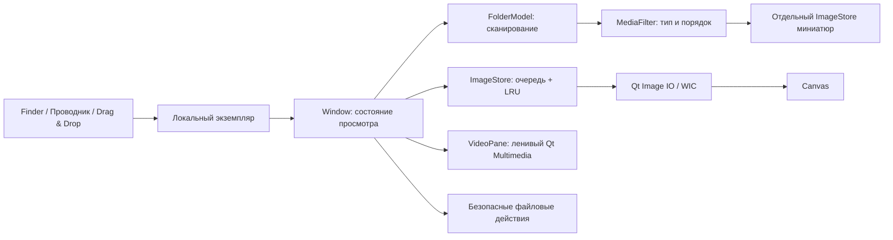

# Wanted View

**Фото и видео. В одном окне.**

Локальный просмотрщик для Windows и macOS. Открываешь файл — листаешь соседние. Никакого импорта в библиотеку, регистрации, сервера или телеметрии.

Wanted View входит в WANTED Labs. Установщики 0.1.0 RC предназначены для приёмки. [Установка и удаление](docs/INSTALL.md) · [Проверки и ограничения](docs/VALIDATION.md).

## Что уже реализовано

- Фото и видео из одной папки; фильтры **Все / Фото / Видео**; естественная сортировка `1, 2, 10`, по дате и размеру. Нерекурсивное сканирование в рабочем потоке.
- Открытие выбранного фото независимо от сканирования папки. Декодирование вне интерфейса, подготовка двух соседних фото, ограниченный кеш и отдельная очередь миниатюр. Видеоплеер создаётся только при первом видео.
- Масштаб колесом, перемещение увеличенного изображения, вписывание, исходный масштаб и поворот **только вида**, без перезаписи оригинала. EXIF-ориентация и перевод встроенного цветового профиля в sRGB через Qt.
- Воспроизведение видео, пауза, перемотка, громкость, выключение звука, скорость 0,5–2×, ограниченное сохранение позиций. GIF/поддерживаемые Qt анимации без кеширования всех кадров.
- Выдвижная лента миниатюр, панель сведений, полный экран, скрытие панелей, светлая и тёмная темы, слайд-шоу.
- Показать в Finder/Проводнике, копировать файл или путь, безопасно переименовать и отправить **в корзину** с подтверждением. При ошибке корзины безвозвратного удаления нет.
- Перетаскивание файла/папки, открытие из командной строки, обработка открытия файлов Finder, один экземпляр приложения через локальный канал текущего пользователя.
- Регистрация в списке приложений Windows по явному действию пользователя и описание типов файлов в macOS bundle. Системный выбор приложения по умолчанию не перехватывается.

Лента пока показывает значок воспроизведения вместо кадров-превью видео. Скрытые файлы и вложенные папки намеренно не включаются в список. При перетаскивании нескольких объектов открывается первый локальный объект; произвольного плейлиста из разных папок пока нет.

## Форматы без обещания «открывает всё»

| Категория | Путь декодирования | Ограничения |
|---|---|---|
| JPEG, PNG, BMP, GIF, ICO | Qt Image IO | Файл должен быть корректным |
| WebP, TIFF | Qt Image Formats | Плагины должны попасть в готовую сборку |
| HEIC / HEIF | Нативный плагин Qt на Mac; WIC на Windows | Windows требует установленного подходящего HEIF-кодека; без него показывается понятная ошибка |
| AVIF | Установленный плагин Qt или WIC | Поддержка не гарантируется в стандартной поставке |
| MP4, MOV, MKV, WebM, AVI и др. | Qt Multimedia / FFmpeg | Расширение контейнера не гарантирует наличие нужного кодека; HDR/Dolby Vision не заявлены |

RAW, Live Photo как единый объект, профессиональный HDR/широкий цветовой охват и редактирование файлов не входят в 0.1.0. Нативный WIC-путь требует отдельной проверки ориентации и цвета настоящих HEIC перед выпуском.

## Быстрый старт разработчика

Нужны CMake 3.24+, компилятор C++20 и Qt **6.5+** с Widgets, Concurrent, Network, Multimedia, MultimediaWidgets, Test. CI использует фиксированный Qt **6.8.3**, а не плавающий `latest`. Для WebP/TIFF/HEIC на Mac также устанавливается Qt Image Formats.

```sh
cmake -S . -B build -G Ninja -DCMAKE_BUILD_TYPE=Release -DBUILD_TESTING=ON
cmake --build build --parallel
ctest --test-dir build --output-on-failure
```

Если Qt не найден, передайте `-DCMAKE_PREFIX_PATH=/путь/к/Qt/6.8.3/платформа`. На Windows запускайте команды в окружении MSVC 2022; Qt должен быть собран для того же компилятора. Для универсального приложения на Mac нужен Qt с обеими архитектурами. Qt 6.8.3 требует SDK macOS 15 для этой сборки: его конфигурация ссылается на AGL, удалённый из более новых SDK. Укажите путь к установленному SDK без смены системного Xcode, например:

```sh
cmake -S . -B build -G Ninja -DCMAKE_BUILD_TYPE=Release -DBUILD_TESTING=ON \
  -DCMAKE_PREFIX_PATH=/путь/к/Qt/6.8.3/macos \
  -DCMAKE_OSX_SYSROOT=/Library/Developer/CommandLineTools/SDKs/MacOSX15.4.sdk \
  '-DCMAKE_OSX_ARCHITECTURES=arm64;x86_64' -DCMAKE_OSX_DEPLOYMENT_TARGET=12.0
```

Запуск:

```sh
# Windows: build/Kadro.exe "C:\Фото\IMG_1234.jpg"
# macOS: open build/Kadro.app --args "/путь/IMG_1234.heic"
# Linux используется для разработки и headless-проверок:
./build/Kadro /путь/к/папке
```

Программа работает с локальными путями. Сетевые URL не поддерживаются. Локально смонтированные сетевые диски обрабатываются системой и могут быть медленными.

### Сборка для передачи пользователю

```sh
cmake --install build --prefix dist --config Release
```

На Mac упакуйте установленный bundle в DMG:

```sh
tools/package_macos.sh dist WantedView-macOS-universal-RC.dmg
```

На Windows x64 выполните в PowerShell с Inno Setup 6.3+ (путь к компилятору зависит от установки):

```powershell
$iscc = Join-Path ${env:ProgramFiles(x86)} 'Inno Setup 6\ISCC.exe'
& $iscc "/DStageDir=$PWD\dist" "/DProductVersion=0.1.0" "/O$PWD" packaging/wanted-view.iss
```

Workflow [Desktop builds](.github/workflows/build.yml) собирает DMG, установщик Windows x64 и portable-пакет. Для Mac он монтирует DMG, копирует приложение и открывает фото и видео из копии. Для Windows он проверяет установку для текущего пользователя, запуск и удаление. Артефакты появляются в Actions после этих проверок. Порядок установки и системного выбора приложения описан в [docs/INSTALL.md](docs/INSTALL.md).

## Управление

| Действие | Клавиши |
|---|---|
| Предыдущий / следующий | ← / → |
| Первый / последний | Home / End |
| Масштаб и перемещение | Колесо, перетаскивание |
| Вписать / исходный масштаб | F / 1 |
| Повернуть вид | R |
| Пауза видео или анимации | Пробел |
| Перемотка видео ±5 секунд | Ctrl/Cmd + ← / → |
| Миниатюры / сведения | T / I |
| Слайд-шоу | S |
| Полный экран | F11 / двойной щелчок |
| Скрыть панели / вернуть | Tab / Esc |
| Открыть / открыть папку | Ctrl/Cmd+O / Ctrl/Cmd+Shift+O |
| Показать в папке | Ctrl/Cmd+R |
| Копировать файл / путь | Ctrl/Cmd+C / Ctrl/Cmd+Shift+C |
| Переименовать / в корзину | F2 / Delete |
| Меню действий | F10 |

## Архитектура



`src/core` не зависит от Qt: классификация расширений, естественная сортировка, проверка имён, навигация и расчёт размеров. Его можно собрать и проверить отдельно:

```sh
cmake -S . -B build-core -DKADRO_BUILD_APP=OFF -DCMAKE_BUILD_TYPE=Release
cmake --build build-core
ctest --test-dir build-core --output-on-failure
```

Кеш изображений — 128 МиБ, миниатюр — 24 МиБ, декодированное изображение ограничивается 24 млн пикселей, Qt allocation limit — 128 МиБ на чтение. Это **не лимит всей памяти процесса**: показанный кадр, промежуточные буферы, мультимедиа и GPU расходуют память дополнительно. При 1:1 слишком большие изображения остаются ограниченными; фактический размер в памяти виден в сведениях.

Настройки хранятся локально через QSettings: геометрия, тема, лента, последняя папка диалога, громкость и до 64 позиций видео. Позиции привязаны к хешу пути/размера/даты, содержимое файлов не хешируется. При обычном запуске последнее фото автоматически не открывается. Постоянного дискового кеша миниатюр нет.

## Дальнейшая работа

`docs/CODEX_HANDOFF.md` — продолжение без повторного проектирования с нуля. `docs/VALIDATION.md` — что проверено и что нет. Сначала реальный запуск пакетов, затем измерения и полировка; не выдавать набор файлов за готовый проверенный релиз.
