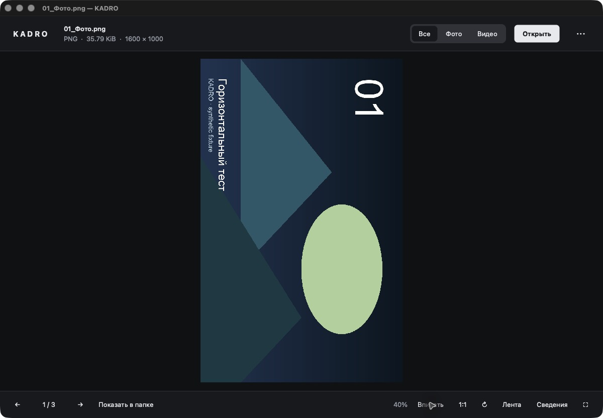

# Проверки KADRO 0.1.0

## Изолированный диагностический профиль, 5 ноября 2026

Добавлен интерактивный запуск `Kadro --settings-dir /абсолютная/папка/профиля /абсолютный/путь/к/файлу`.
Он переключает настройки приложения на INI в подпапках `user` и `system` указанного профиля до создания окна. Резервное чтение настроек организации/системы также остаётся внутри профиля; идентификаторы Kadro не переименовываются. Общие lock/socket обычного экземпляра не открываются. Это изоляция настроек приложения и IPC, а не системная песочница.

Неверный, относительный, корневой или недоступный для записи путь завершает запуск с кодом 5 и сообщением, без переключения на пользовательские настройки. Папки уровней `user`/`system` не могут быть символическими ссылками. Явный профиль имеет приоритет при сочетании со `--smoke-screenshot`; только этот smoke-флаг включает автоматическое завершение. Без него интерактивное окно остаётся открытым. Smoke без явной папки использует временный профиль с обоими уровнями и отдельный процесс. Обычный запуск без диагностических флагов сохраняет прежний NativeFormat/IPC.

Новый `settings_profile` — отдельный QtCore-only тест, без окна и мультимедиа. На macOS arm64/Qt 6.8.3 выполнены 105 проверок: четыре синтетических уровня fallback, INI user/system, сохранение реальных ключей, пути с кириллицей/пробелами, отклонение недопустимых путей без смены назначения, неизменность байтов исходного синтетического профиля и CLI-изоляция. Setup существующих UI-тестов теперь также использует оба изолированных уровня. Эти проверки не заменяют нативную приёмку GUI/установленного пакета; её результат записывается отдельно после выполнения.

```sh
ctest --test-dir build -R '^settings_profile$' --output-on-failure
```

## Локальная приёмка установленного пакета, 5 ноября 2026

Платформа этого прогона: macOS 26.6.2 / arm64, Qt 6.8.3 из отдельного SDK, AppleClang 21; локальная сборка ограничена двумя потоками. Ранее зафиксированный официальный AGL-патч применён только к конфигурации SDK. Новые библиотеки и Docker не устанавливались/не запускались. Пакет получен штатным `cmake --install`/`macdeployqt`, без путей Qt разработчика в окружении запуска. В нём присутствуют 18 плагинов, включая Cocoa, imageformats и FFmpeg/Darwin multimedia; 25 загруженных путей Qt/мультимедиа относились к пакету, не к SDK. Это не чистая ОС без SDK и не подписанный/notarized релиз.

Подтверждены реальные нативные окна: собственные горизонтальное и портретное PNG → переход стрелками → 1:1, вписывание и поворот кнопкой → H.264/AAC test pattern → пробел/пауза → Cmd+←/→, перемотка на 5 секунд → возврат к фото → закрытие. Два последовательных кадра содержат разные номера 11/12 и отличаются визуально: это наблюдение видимой поверхности, а не только сигнал QVideoSink. Физическое нажатие фильтра «Фото» оставило два фото; AX-действие инструмента наблюдения только меняло флажок без обновления списка, поэтому оно не использовано как доказательство фильтрации. Буквенная клавиша R этим прогоном не подтверждена; поворот кнопкой подтверждён. Слышимость звука не проверена.

Отдельный собственный 12-секундный H.264/AAC-клип поставлен на паузу в 5000 мс; после закрытия это значение найдено в собственном INI. Нативный повторный запуск наблюдался уже после нескольких секунд автопроигрывания, поэтому скриншот не доказывает точный первый кадр на 5000 мс. Для точной проверки добавлена Qt-регрессия `resumeTwelveSecondVideoAtFiveSeconds`: собственный 12-секундный MJPEG AVI, настоящий QMediaPlayer, сохранение/повторное открытие, событие позиции 5000 мс в пределах 2 секунд (из нуля естественным проигрыванием оно недостижимо). Фактическая последовательность после повторного открытия: `QList(5000)`. Это Qt offscreen-проверка, её не следует выдавать за отдельный нативный снимок.

Полный локальный CTest: 3/3 targets; ядро — 492 проверки, settings profile — 105 проверок, UI — 8 содержательных сценариев плюс init/cleanup = 10 passed, 0 failed/skipped. Существующие предупреждения технического MJPEG (`EOI missing`, pixel format), offscreen и отсутствие аппаратного декодера в тестовой среде раскрыты в журнале; они не заменены обещанием аппаратного ускорения. Проверки повреждённого изображения/ошибки чтения остаются частью UI-suite; отдельная ручная нативная проверка всех ошибок кодеков не выполнена.

**Ограничение изоляции самого прогона:** два обращения CUA к приложению привели к неожиданным повторным запускам пакета без исходных аргументов (после закрытия и при попытке раннего подключения наблюдателя). Оба обычных процесса остановлены по точным PID; второй эксперимент отвергнут, дальнейшее управление CUA прекращено. Исходный код показывает чтение обычной геометрии/темы/ленты при пустом старте; запись есть на closeEvent и пользовательских действиях. Реальные настройки не читались для аудита и не восстанавливались вслепую: возможное чтение при этих стартах и неизвестность записи сохранены как ограничение. Утверждение «обычные настройки остались неизменны» не делается. Успешные INI-тесты доказывают изоляцию явно выбранного профиля, а не безошибочность внешнего наблюдателя.



Все тестовые медиа собственные; SHA/размер/mtime оригиналов и рабочих копий сверяются отдельно в журнале. Пользовательские файлы, системные ассоциации, rename/trash и настройки ОС не проверялись и не менялись намеренно. Не проверены Windows/Intel Mac в новом прогоне, реальные iPhone HEIC/HEVC, все EXIF-положения, HDR, слышимость и аппаратное декодирование. Исторические CI-результаты ниже сохраняются как исторические.

## Исторические результаты

Состояние на 16 октября 2026 года. Проверенный код: `817788ae2b4622cbd2bc463bd8d22e499b5e85c2`.

## Подтверждённый прогон

GitHub Actions **Desktop builds №2**, запуск `38946709900`: **success**.

https://github.com/MikhailMostWanted/kadro/actions/runs/38946709900

| Среда | Компиляция | CTest: core + ui | Упаковка | Запуск установленного пакета: PNG + декодирование MJPEG AVI |
|---|---|---|---|---|
| Windows, runner windows-2022, x64 | Успешно | Успешно | Успешно | Успешно |
| macOS 15, universal arm64 + x86_64 | Успешно | Успешно, исполнение arm64 | Успешно | Успешно, исполнение arm64 |
| Ubuntu 24.04, x64 | Успешно | Успешно | Не выполнялась | Не выполнялся |

Во всех трёх сборках используется Qt 6.8.3. Универсальная сборка Mac содержит обе архитектуры, но выполнение Intel-части этим прогоном не проверено. Windows runner — не проверка установки на пользовательскую Windows 10/11.

Первый прогон №1 остановился на отсутствующем заголовке QVideoFrame в тесте видео. Во втором коммите это исправлено; повторный полный прогон прошёл. Тесты не отключались и не заменялись заглушками для получения зелёного статуса.

## Что именно проверено

Независимое ядро: **492 проверки** классификации расширений, естественной сортировки, свойств компаратора, допустимости имён, навигации и размеров изображений. Дополнительно локально выполнена сборка GCC с AddressSanitizer и UndefinedBehaviorSanitizer: те же 492 проверки прошли без диагностик санитайзеров.

Qt-тесты содержат семь содержательных сценариев: чтение и повреждённые изображения; фильтрация и естественная сортировка; отбрасывание устаревшего сканирования; ограничение очереди и кеша; безопасное переименование; открытие окна и быстрое листание; декодирование настоящего видеокадра, пауза и остановка. Qt Test дополнительно считает initTestCase и cleanupTestCase: на Mac журнал показывает 9 passed, 0 failed, 0 skipped. Это не девять отдельных пользовательских сценариев.

Тестовые фото и MJPEG AVI создаются кодом. Пользовательских медиа в репозитории нет. Тесты не меняют ассоциации файлов и не отправляют существующие файлы в реальную корзину.

`tools/check_package.py` запускает установленное приложение из временного рабочего каталога, удалив из окружения пути к Qt разработчика. Используются нативные оконные плагины Windows/macOS. Фото должно декодироваться, видео должно дать валидный кадр в QVideoSink; иначе процесс завершается с ошибкой. Диагностический режим хранит настройки во временной папке. Это проверка комплектности пакета в CI, а не отдельная чистая ОС без установленного SDK.

## Визуальные свидетельства и граница проверки видео

Настоящие снимки окна сохранены в артефактах `evidence-windows-x64`, `evidence-macos-universal`, `evidence-linux-test`. Снимки `packaged-photo.png` с Windows и Mac просмотрены: изображение, русские панели, фильтры, сведения о разрешении и нижние кнопки видны без наложения друг на друга при размере окна этого прогона.

**В снимке `packaged-video.png` с Mac видеоповерхность не видна, хотя QVideoSink получил валидный декодированный кадр.** Поэтому зелёный тест декодирования нельзя выдавать за подтверждение видимой отрисовки видео, звука и аппаратного ускорения. Отображение видео на реальном экране нужно проверить отдельно; причина пустой области в захвате окна пока не установлена. В журнале также есть предупреждения FFmpeg при чтении технической MJPEG-фикстуры; этот тест не заменяет проверку настоящих H.264/HEVC-файлов.

## Полученные пакеты

В указанном успешном запуске доступны `Kadro-windows-x64` и `Kadro-macos-universal`. Windows: распаковать весь архив и запускать `bin/Kadro.exe`; одного EXE недостаточно. Mac: внутри артефакта ZIP, сохраняющий структуру приложения и ссылки фреймворков; приложение находится в `dist/Kadro.app`.

Это неподписанные тестовые сборки. Подпись Windows, нотариальное заверение Apple и комплект лицензий для публичного распространения ещё не подготовлены. Программа не отключает системные проверки безопасности.

## Не подтверждено до ручного прогона

Чистая пользовательская Windows/macOS без Qt SDK; видимая отрисовка видео и звук; Intel Mac; HEIC/HEVC с конкретного iPhone; все EXIF-ориентации и цвет WIC; HDR; аппаратное декодирование на GPU пользователя; холодный старт и 10 000 реальных больших файлов; Finder/LaunchServices и Windows default associations; корзина и файловые блокировки на локальных/сетевых томах; подпись, нотариальное заверение и публичная лицензионная комплектность.

## Ручной маршрут приёмки

Открыть файл двойным щелчком → 100 быстрых переходов → Все/Фото/Видео → лента → масштаб/поворот → убедиться, что **видно движущееся видео и слышен звук**, проверить паузу/перемотку/скорость → вернуть фото → показать в папке → копировать в файловый менеджер → переименовать копию → отправить копию в корзину/восстановить → открыть второй файл извне → закрыть во время декодирования. Повторить со светлой темой, узким окном и HiDPI. Проверить, что просмотр не изменил хеш/размер/mtime оригиналов.
